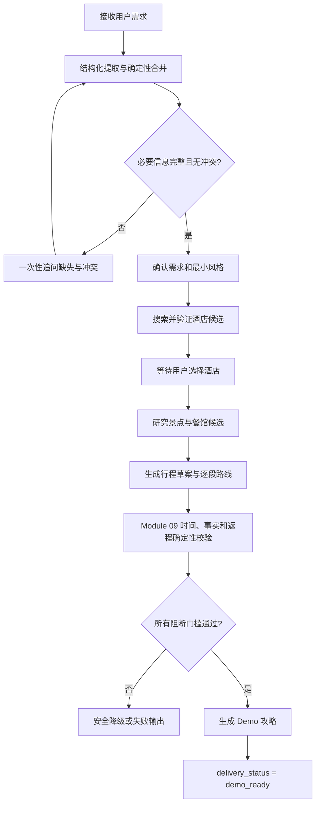
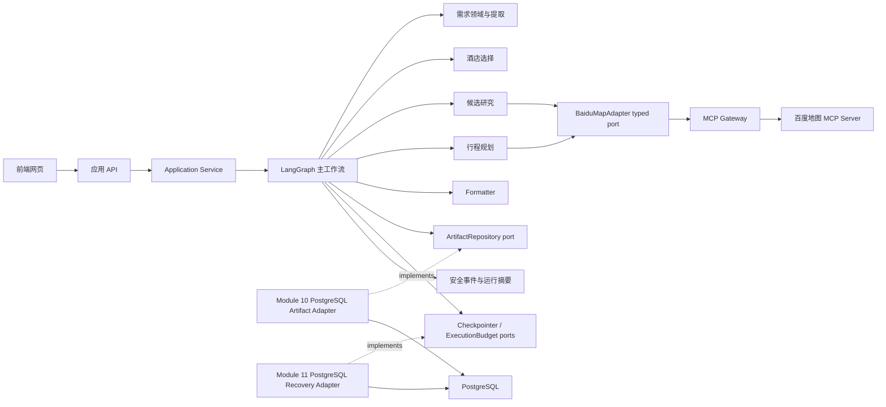

# 中国境内旅游攻略 Agent 主干设计

> 公开设计资料：个人路径、实例标识和具体运维环境已改为通用示例。历史验收链接统一指向[公开验证说明](VALIDATION.md)；技术合同与限制保留。

> 本次维护沿原模块文档修订： [M09阶段/预算/版本§12～15/20/25](09_itinerary_planning_loop.md)、[M02完整采集§19](02_llm_runtime_and_model_profiles.md)、[M10存储/导出§23](10_artifact_persistence.md)；实施边界归 [原M09执行规范§29](09_itinerary_planning_loop_vibe_coding.md)。 用户已批准本次设计并授权实施，核心代码及离线门禁已落实；最终验收与真实 API 状态见 [本次报告](VALIDATION.md)。

> 文档状态：v3.3（M14设计独立审查通过；用户2026-10-05批准并授权模块实施，提交/发布仍未授权）
> 适用范围：网页 Demo、Production v1 应用核心及其兼容演进
> 当前实现状态：见 [`IMPLEMENTATION_STATUS.md`](VALIDATION.md)
> 交付顺序与模块索引：见 [`IMPLEMENTATION_ROADMAP.md`](IMPLEMENTATION_ROADMAP.md)
> 通用实施规则：见 [`SHARED_IMPLEMENTATION_RULES.md`](SHARED_IMPLEMENTATION_RULES.md)

## 1. 文档职责与权威层级

本文只定义长期稳定的内容：产品边界、用户旅程、事实可信边界、跨模块状态与错误语义、依赖方向、运行预算、安全不变量和发布门槛。

本文不保存易变的测试数量、当前 HEAD、Prompt hash、依赖安装命令、文件白名单、供应商原始字段或逐任务实现步骤。它们分别由状态文档、模块规范和面向弱模型的精确执行契约维护。

发生冲突时必须停止并按以下层级核验，禁止编码 Agent 自行挑选对自己最方便的版本：

1. 用户最新明确批准的产品或架构决策。
2. 本文：产品边界与跨模块不变量。
3. 单一模块规范：该模块拥有的公共 DTO、Protocol、错误和行为合同。
4. 可执行合同测试：证明实现符合规范，不得反向修改规范语义。
5. `_vibe_coding.md`：面向能力较弱编码模型的精确执行契约，说明允许修改的文件、精确符号、算法顺序、测试矩阵、停止条件和报告格式；不得重新定义上位合同。
6. `IMPLEMENTATION_STATUS.md`：特定 HEAD 上观察到的验证事实，不是设计真源。
7. 当前代码：必须实现上述合同；不得用既有实现反向覆盖已批准语义。

只有用户明确批准需求或架构变更时，才能先修改上位规范再修改代码。发现文档之间、文档与测试或文档与代码冲突时，先报告证据和最小修正范围。

## 2. 产品定义

Agent 面向中国境内单一核心城市旅游，根据用户的时间、同行人员和偏好，生成从抵达目的地机场或火车站开始，到返程进入机场或火车站为止的完整攻略。

### 2.1 网页 Demo

Demo 目标是“小而美、真实可运行、可继续扩展”，开发应用核心、应用 API 和前端网页；网页是正式交互与验收入口，CLI 仅可作为诊断辅助：

- 支持一个核心城市及可当天往返的周边游。
- 全程只使用一家经用户确认的酒店。
- 只支持出发前规划，不做旅途中主动重排。
- 提供酒店、景点、餐馆、逐段路线、既有天气提示和费用核验状态；本期预算金额延期。
- 关键地点、坐标和路线必须来自百度地图事实。
- 用户明确要求时才生成地图可视化链接。
- Module 10/11 完成前只支持同一进程内 LangGraph interrupt/resume；完成后使用 PostgreSQL 保存 Artifact、checkpoint 和执行账本，支持已安全持久化的人工暂停跨进程恢复；研究与规划私有模型上下文丢失时失败关闭，不承诺任意中途续跑。
- 杭州是主要验收城市，但 POI 必须实时来自百度地图，不使用本地杭州事实库。

允许 Dockerfile/Compose 作为本地开发、离线测试和依赖复现工具。M14已确认采用单机Docker Compose准备公开受限匿名Demo，具体合同见 [M14 §2、§5–12](14_web_application.md)；这不构成实际部署授权。PostgreSQL 从 Module 10/11 起成为持久化 Demo 和最终发布 Gate 的运行依赖。

### 2.2 Demo 明确不做

- 跨城市串联或中途换酒店。
- 代订、下单、支付、退改或交易。
- 实时余房、门票库存和成交价格保证。
- 主动后台监控、主动推送和长期记忆。
- 小程序、完整公众多用户产品、实名账号权限系统和安装包发布。M14的公开受限匿名Demo是有界例外：单执行、无业务队列、配额和归属隔离、单机Docker Compose；网页/API框架已选FastAPI及原生HTML/CSS/JS，实际发布仍另行授权，不在M13实施。
- 把大模型常识当作地点、坐标、路线、价格或实时政策事实。
- 在关键地图验证失败时输出伪装成可执行结果的正式攻略。

### 2.3 Production v1 与 Future

Production v1 在网页 Demo 的应用核心上增加可审计和数据生命周期控制；M14仅已确认公开受限匿名体验的设计范围，不包含完整多用户产品或实名账号权限，也不自动授权部署。持久化 Demo 的目标形态由 Module 10/11 建立 PostgreSQL checkpoint、持久 Artifact 和跨进程恢复；Production v1 在该目标形态上增加用户主动触发的局部重排、安全生命周期、可观测性和长期恢复验证。当前实现进度以 `IMPLEMENTATION_STATUS.md` 为准。

Production v1 必须兼容演进 Demo 已发布合同；允许通过版本化新能力扩展端口，不承诺所有未来需求都能仅靠替换适配器完成。若持久化、删除或并发要求需要新增 Protocol 方法，必须提供兼容迁移和合同测试，不能静默改变旧方法语义。

完整公共多用户产品、独立预订价格供应商、自动交易和长期向量记忆属于 Future。M14已确认的有界匿名体验和单机容器方案沿其设计验收，不扩大为这些Future能力；实际部署仍须明确授权。

## 3. 用户需求与核心旅程

### 3.1 正式规划的必要信息

正式规划前必须取得：

- 目的城市、旅游天数、游览开始与结束日期。
- 到达和离开交通枢纽、日期及预计时间。
- 本期不采集或追问预算金额，不把金额作为确认门槛；继承 12_budget_amount_deferral.md，历史非空金额只读兼容。
- 兴趣偏好及行程节奏，或明确选择由 Agent 决定。

网页新任务采用 [M14“有效输入与历史兼容”](14_web_application.md#有效输入与历史兼容)。人数、儿童年龄、房间数量、房型、行动限制和饮食禁忌暂不收集或作为确认门槛；后端字段和旧任务的校验、读取及恢复能力保留。交通偏好、每日作息、活动时刻和时长维持现状，本次不启用新的排程能力。

兴趣偏好采用最小模型：人文、自然、美食、打卡，可多选；行程节奏为轻松、标准、紧凑。用户没有选择时提供最小选项，不建立复杂标签平台。

缺失、冲突和显式修订由模块 01 的权威规范处理。到达/离开日期、游览日期和天数不一致时不得猜测，必须一次性列出冲突并暂停规划。

### 3.2 核心交互流程



酒店选择是人工门槛。最多进行 3 次 Place 搜索；得到至少 3 家具有不同百度 UID、名称和有效坐标的酒店后停止。三次后不足 3 家时返回固定失败，不复制、补造或把普通地点改写为酒店。

“地图已核验酒店”只表示地点身份和坐标来自百度，不表示实时有房、房型可订、取消政策或成交价格可信。

## 4. 事实可信与输出合同

### 4.1 事实分级

| 等级 | 典型事实 | 对 `demo_ready` 的影响 | 输出规则 |
|---|---|---|---|
| 阻断事实 | 已选酒店身份与坐标、主行程 POI 身份与坐标、抵达/每日/返程主路线 | 缺失或验证失败即不得 `demo_ready` | 必须有百度来源、获取时间和验证状态 |
| 可降级事实 | 本期启用的主行程营业时间、用户请求的可选展示能力 | 缺失时可继续，但交付状态为 `degraded`，不得伪装 `demo_ready` | 只能表述供应商实际返回内容 |
| 建议性声明 | 菜品建议、过敏原安全、无障碍适配、实时库存 | 永远不能作为已验证事实 | 只能作为待用户复核提示，不参与硬判定 |

百度负责其响应实际返回的地点、地址、坐标、路线、天气和地图资源。用户约束可以进入语义查询，但供应商未明确返回的匹配属性不得提升为事实。

### 4.2 用户预算与费用核验状态

预算只覆盖抵达目的地后的住宿、当地交通、餐饮、景点和其他当地消费，不包含往返目的地的大交通。

- 只有用户明确提供或供应商明确返回的价格才能计入可信费用。
- 百度酒店价格只能标记为“百度参考价”，不能表述为实时房价或可订价格。
- 未知费用按类别列出，不用区间中点、经验值或模型常识补齐。
- 当前 Demo 没有酒店房价、门票、餐饮人均和交通计价的可信结构化来源，本期不采集预算金额，逐类标记费用未核验；不得声称预算合规，也不得因此阻塞当前已批准功能范围的 `demo_ready`。
- 可信价格来源及其证据合同以后另行批准；启用后才输出已核验费用小计和剩余预算空间，已核验费用超过总预算时固定失败，不得擅自降低酒店、删除景点或自动重启整个规划阶段。

### 4.3 Demo 攻略

正式攻略至少包含：

- 城市、日期、天数、同行人员、已确认酒店和关键限制。
- 每日主题、时间区间、主景点、餐馆和天气提示。
- 相邻主地点之间的交通方式、距离和预计耗时；费用没有可信来源时明确标记未核验。
- 可以提供关键节点的附近备选；按 D-09-69，备选可缺省，不专门为补备选启动研究；备选未进入主路线前不伪装成已完成路线验证。
- 未核验费用类别和复核提示；新攻略不显示预算金额，历史非空金额沿用原文案只读展示。只有将来启用经批准的可信价格证据与金额能力后，才显示已核验小计或剩余预算空间。
- 最后一天前往返程枢纽的路线和安全余量。
- 事实来源、获取时间、验证状态和需要用户复核的声明。

每天最多 4 个景点、1 个午餐地点和 1 个晚餐地点，进入主路线的地点最多 6 个。时间使用合理区间，不制造没有依据的分钟级精度。

Formatter 只能表达状态中的事实、估算和验证标签，不得新增地点、价格、坐标、路线或政策。

## 5. 总体架构与所有权



固定依赖方向：

```text
领域合同 → 供应商适配/业务能力 → 主工作流 → Application Service / Web API
工作流合同 → Graph、预算和 artifact 的消费者
基础设施实现 → 实现稳定端口，不反向定义业务语义
```

| 组件 | 唯一职责 | 禁止 |
|---|---|---|
| LangChain / DeepSeek Runtime | 模型构造、结构化输出、tool schema、错误与重试 | 决定工作流路由、执行 MCP、保存 Graph state |
| LangGraph | 主流程、条件边、受控循环、interrupt/resume | 解析供应商原始 payload、复制领域规则 |
| 运行时能力模块 | 单一业务目标、输入输出 DTO、允许工具、预算和停止条件 | 充当第二套主编排器、直接管理 MCP session |
| BaiduMapAdapter / MCP Gateway | 外部协议、工具白名单、规范化和技术限流 | 决定酒店选择、行程和预算 |
| 确定性领域服务 | 规范化、业务校验和格式化 | 调用未知外部能力、补造事实 |
| Application Service / Web API | 依赖装配、命令与交互 | 复制业务规则或直接操作 Graph 内部状态 |

模块 04 拥有工作流 DTO、状态、artifact/repository 端口及其 Demo 进程内参考实现；模块 05 拥有需求子图与同进程恢复基础；模块 10 提供 PostgreSQL Artifact 持久实现，模块 11 提供 PostgreSQL checkpoint、执行账本和跨进程恢复；模块 13 装配这些实现，并且是完整 Demo 主图、跨能力路由和终态映射的唯一所有者。模块 14 提供 Application Service、运行资源装配、应用 API 和前端网页。M13 只接收借用依赖并定义主图，不创建第二套应用服务或供应商生命周期。

所有被代码消费的模型输出必须经过 Schema 约束和本地 strict validation。禁止用自由文本或未经严格验证的 JSON 驱动状态更新、条件分支或工具执行。面向用户且不被程序反向消费的文本可以由模型表达，但不得补写状态中不存在的事实。

## 6. 工作流状态、错误与幂等

### 6.1 三个正交状态维度

`TravelSessionState` 使用三个正交概念，禁止互相代替：

- `phase`：当前或最后执行的业务阶段，例如需求收集、酒店选择、候选研究、规划和格式化；Module 09 的确定性提交校验属于规划阶段，不另设业务 phase；不包含 `demo_ready/failed` 等交付结论。
- `delivery_status`：`in_progress | awaiting_user | demo_ready | degraded | failed | cancelled`。
- `terminal_code`：安全、稳定、可机器判断的终止原因；非终态为 `null`。

`demo_ready` 必须且只能由完整主图所有者在当前已批准功能范围内的阻断事实和完整性门槛通过后写入。当前费用能力未启用，未知费用必须显式标记但不作预算合规判定；模块错误不得直接修改交付状态，只返回 typed outcome。

终态判定固定为：

- `demo_ready`：当前已批准功能范围内的所有阻断事实和完整性门槛通过，且本次请求所需的已启用可降级事实/可选能力均成功。
- `degraded`：所有阻断事实和安全门槛通过，仍可交付安全攻略，但主行程营业时间未知或用户请求的可选展示能力缺失；输出必须逐项标为未核验/不可用。尚未启用的费用能力按固定未核验标签输出，不单独触发降级。
- `failed`：任一阻断事实、已核验费用上限、安全门槛或完整性门槛失败，不能输出伪装成可执行的正式攻略。

只有用户在执行前明确声明不需要某项可选事实/能力时，该项才不计入本次请求的缺失。运行后再接受失败结果不会把 `degraded` 升级为 `demo_ready`。

本期适用门槛由 D-13-02、D-13-07 冻结：天气整体排除；仅主行程营业未知影响整体标签；费用、未启用的参考价格/预约/临时政策保留未核验说明，不因没有相应事实能力而额外降级。备选可省略。合法的研究 Incomplete 本身也不降级，最终行程必须 Completed。demo_ready 的中文标签固定为“完整达标”，仅表示当前批准范围达标，不承诺库存、预订或费用合规。地图展示被明确请求但尚未提供时仍降级。

失败终态的最小安全信封为：

```text
TerminalOutcome
├── terminal_code
├── category: input | configuration | provider | tool | validation | budget | internal
├── recoverable
├── user_action_code | null
└── trace_id
```

模块拥有自己的 typed error；模块 13 负责映射为终态，模块 14 负责安全用户文案和应用 API 状态。原始异常、Prompt、用户原文、供应商 body 和推理不得进入终态信封。

### 6.2 小状态与 artifact

Graph state 只保存小型可序列化状态和 artifact 引用，不保存大型候选集、路线响应、攻略正文、供应商对象、MCP session 或 LangChain Runnable。

稳定引用最少包含 `artifact_id、artifact_type、schema_version、content_hash`。Demo 仓储保存规范化 DTO；Production 可以通过版本化扩展增加所有权、删除、并发和历史读取能力。

### 6.3 interrupt/resume 幂等

所有人工确认统一使用 LangGraph `interrupt()` 和同一 `thread_id` 的 `Command(resume=...)`。恢复会从节点开头重新执行，因此必须满足：

1. interrupt 尽量位于外部副作用之前。
2. 每个可能重复的副作用具有稳定 `operation_id`，至少由 `run_id + phase + logical_step` 构成。
3. artifact 写入按 operation ID 和 content hash 幂等；同键同内容返回同一引用，同键不同内容产生冲突。
4. 预算申请、外部调用结果登记和终态写入必须原子或可检测重复。
5. 已持久到 artifact 的外部结果在节点重放时复用，不重复调用模型或地图。
6. interrupt/resume 后所有调用和迭代计数不得重置。

模块 04 冻结 DTO 和端口语义，模块 05 验证节点重放，模块 10/11 持久化 Artifact、checkpoint、operation journal 和执行预算，模块 13 负责跨模块 operation ID 与执行预算一致性。

## 7. 受控模型循环与运行预算

开放式 ReAct 只允许在候选研究、行程规划和 Production 局部重排中使用。必要字段判定、人工确认、执行预算、安全、完整性、状态保存和格式化必须是确定性流程。

每个循环必须定义工具白名单、迭代与调用上限、成功停止条件、重复检测、缓存、超时和失败状态；只记录安全 Action/Observation 摘要，不保存模型私有思维链。

Demo 全局执行上限：

| 项目 | 上限 |
|---|---:|
| 需求补充轮次 | 6 |
| 单轮需求提取语义调用 | 2（extract 1 + repair 1） |
| 酒店 Place 调用 | 3 |
| 候选研究 ReAct 迭代 | 6 |
| 候选研究 Place 调用 | 48 |
| 行程规划 ReAct 迭代 | 6 |
| 独立地图查询并发 | 3 |
| Direction | `8 × days + 2` |
| 整阶段自动重启 | 0 |

执行预算由工作流/能力模块申请和主编排器强制；BaiduMapAdapter 只负责单次调用技术超时、协议错误和并发限制，不依赖 Graph durable state。

## 8. 百度地图能力边界

业务代码只依赖 typed `BaiduMapAdapter`，MCP Gateway 负责连接、工具白名单、协议错误和原始响应清洗。

Demo 发布前，Geocoding、Reverse Geocoding、Place Search、Place Details、Route Matrix、Direction 和 Weather 七项 adapter capability probe 都必须通过；这是模块 06/发布资格门，不表示每次行程都必须调用全部七项能力，也不表示天气在每次行程中都成为阻断事实。单次运行中 Place Search、Place Details、Geocoding、Route Matrix 或 Direction 的阻断事实失败时交付 `failed`；Reverse Geocoding 只阻塞依赖当前位置的流程；本期天气不纳入单次交付判定，不增加天气确认交互；M12 的“天气未获取”提示保留。Map Launch 是可选能力，只影响用户明确请求的地图展示，失败时可交付不含地图展示的 `degraded` 攻略，不得阻塞普通 Demo 攻略。

固定安全规则：凭证只来自安全配置；坐标只来自用户或可信工具；首版内部统一使用 BD-09LL；原始供应商 payload 不进入业务层和持久状态；超时、鉴权、限流、无结果、歧义和协议错误映射为 typed error。不得使用非官方近似算法在坐标系之间静默转换；未来引入其他坐标系时必须使用显式坐标类型和经批准的官方转换边界。

## 9. 安全、隐私与可观测性

- Secret 只来自进程环境或被 Git 忽略的根目录 `.env`，环境优先。
- 日志禁止记录 Secret、Authorization、完整 Prompt、用户敏感原文、模型原始响应、供应商 payload 和私有推理。
- Demo 默认不写本地 session 文件、不保存原始地图响应、不启用长期记忆。
- 用户当前位置只用于当前进程和必要路线计算。
- 每个事实保存来源、获取时间和验证状态。
- `RunSummary` 只保存 run/trace ID、安全计数、耗时、缓存命中和终态码。M14计划在同一PostgreSQL数据库的自有schema保存真正生成的最终完整摘要，读回后验证身份/hash/终态；正常保存后释放完整事件，诊断保存失败也释放事件、仅暂留小摘要有限重试，不改变合格攻略。M04 DTO和M13历史不全例外不变，详见 [M14 §9](14_web_application.md)。
- Demo 观测端口由模块 04 定义，模块 13 聚合；Production 排队、指标、Trace、审计和 redaction adapter 属于模块 20。

网页取消先持久记录意图并显示“正在取消”，只在安全收束确认后显示“已取消”（cancelled/cancelled_by_user）。浏览器刷新、关闭和断线不取消后端任务。未知外部结果、失租或数据库提交结果不确定时不得伪称已取消；按 M11 §22 执行。CLI 如实现，其 Ctrl+C 只能转交同一取消协议。

## 10. 验收与发布语义

### 10.1 三类证据

- `contract_complete`：离线单元、属性和合同测试证明确定性合同完成。
- `live_qualified`：在指定模型、Prompt hash、依赖版本和日期上完成一次真实资格验证。
- `reliability_evaluated`：通过多次或滚动样本评估外部服务稳定性；一次 live 全绿不能替代。

后续模块可以要求前置模块同时具备 `contract_complete` 和有效 `live_qualified`，但供应商短期波动不会反向改变已冻结的确定性公共合同。依赖、模型、Prompt 或能力边界变化后必须重新资格验证。

### 10.2 早期纵向集成

不能等所有 Demo 组件完成后才首次集成。工作流基础和地图 Gateway 完成后必须建立一个非 `demo_ready` 的纵向检查：需求输入 → 同进程 interrupt/resume → 一次 typed 地图调用 → 安全结构化输出。后续规划能力使用 fake 占位，不把该检查冒充完整 E2E。

### 10.3 Demo release gate

Demo 最终门包含：

1. 一条真实杭州网页主链：真实 PostgreSQL、DeepSeek、百度地图、interrupt/resume、酒店选择、规划、路线、跨进程恢复和 `demo_ready`。
2. 3–5 个固定质量场景：普通双人、儿童条件字段、老人/行动限制、进程崩溃恢复、地图歧义或失败。
3. 硬约束满足、主路线事实证据、未核验价格标注和禁止虚构事实均为 100%。
4. 覆盖 `demo_ready、degraded、failed、awaiting_user` 和取消路径。
5. 所有调用、迭代、超时、敏感日志和退出码断言可机器执行。

单条真实 E2E 只证明该次系统能够运行；不能宣称推荐最优或生产质量。Production 的城市泛化、局部重排一致性和滚动可靠性由独立质量 Gate 负责。

## 11. 文档与交付治理

代码组件、工作包和 Gate 是不同概念：

- Component：单一代码职责和依赖边界。
- Work package：一次设计、实现和联调的交付单元，可包含多个保持独立的组件。
- Gate：只验证，不拥有生产能力。

后续职责、依赖和工作包只在 `IMPLEMENTATION_ROADMAP.md` 维护一个真源，不在本文重复 DAG 和并行批次。满足 `depends_on` 和 acceptance gate 即可开始；是否并行由用户授权和文件所有权决定。

每个组件保留一份权威模块规范。`_vibe_coding.md` 面向能力较弱的编码模型，必须足够精确和自包含：保留文件白名单、公共符号、逐阶段任务、关键伪代码、边界表、测试命令、停止条件和报告模板。为了防止模型自由发挥，可以有意重复关键不变量，但任何重复内容都必须能由文档检查同步验证；公共合同的唯一语义真源仍是模块规范，Prompt 文本真源仍是资源文件。

拆分与合并以外部系统所有权、独立状态机、领域/基础设施边界、数据生命周期和编译依赖为依据。“任务数量、目录数量、需要阅读的文件数”只能作为评审信号，不能机械决定架构。

## 12. ADR 索引

| ADR | 决策主题 | 权威章节 |
|---|---|---|
| ADR-001 | 网页 Demo 与范围边界 | 第 2–3 节 |
| ADR-002 | 事实可信、用户预算、费用核验状态和输出 | 第 4、8 节 |
| ADR-003 | LangChain、LangGraph、MCP 与依赖方向 | 第 5 节 |
| ADR-004 | 状态、错误与 interrupt 幂等 | 第 6 节 |
| ADR-005 | 受控循环和全局执行预算 | 第 7 节 |
| ADR-006 | 安全、资格验证与 Demo Gate | 第 9–10 节 |
| ADR-007 | Component、Work package 和 Gate 分离 | 第 11 节 |
