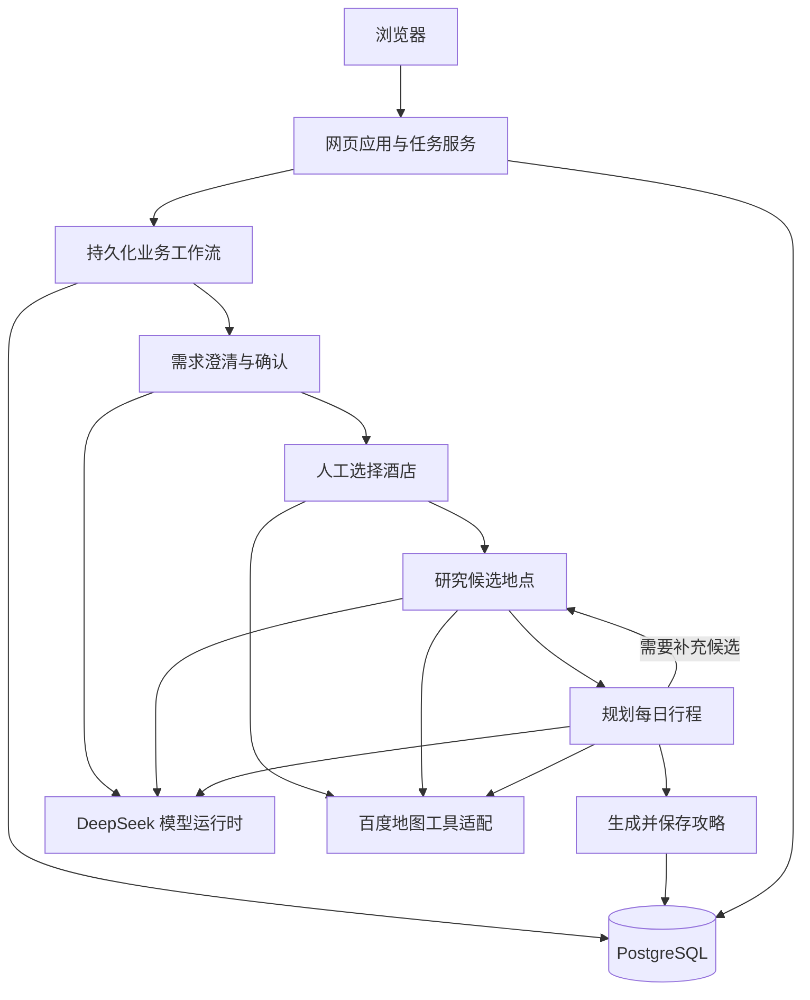

# 架构说明

## 从需求到结果

生产入口 `python -m app.web_application` 装配真实模型、地图工具和 PostgreSQL，网页资源随应用一起构建。网页提供业务操作和状态展示，LangGraph 工作流负责阶段切换和受控循环，各业务模块通过明确的输入、输出和领域协议交换信息。

模型由 `app.llm_runtime` 统一调用，业务模块使用自己的提示词、结构化输出和预算约束。地图能力由 `app.baidu_map` 通过受信任的 MCP 工具接口提供，业务模块使用领域适配接口，不自行管理供应商连接。

酒店必须由用户选择。候选研究与规划根据已有证据作出决策，规划可以要求受控补研。只有主行程与完整结果索引均通过校验，才会形成可交付的完成状态；部分研究结果不能直接当作完整攻略交付。

## 数据与身份

`app.artifact_persistence` 保存业务产物与交互记录，`app.durable_execution` 保存执行账本和检查点，`app.web_application` 保存访客、任务页面状态、配额和运行摘要。它们使用同一部署项目内的 PostgreSQL，但采用独立、显式的迁移入口。

访客身份由 Cookie 区分，查看和操作任务时会核对所属访客。页面关闭不等于取消工作流；取消、恢复和人工确认必须通过对应的业务操作完成。

暂停凭证由部署者生成的独立密钥加密。应用启动不会自动生成或替换这个密钥。已有数据库和原密钥必须一起保存，才能继续读取相应数据。

## 运行与测试

应用在容器中使用单个进程和单个执行名额。数据库迁移不在应用启动时自动执行，生产装配也不包含测试控制接口。

测试目录包含模拟模型、地图与业务服务，以及显式启动的测试服务。它们用于验证协议和页面行为，不能证明真实供应商可用、规划质量最优或任意故障后的恢复能力。真实调用、数据库迁移和云端部署应分别验证。

旧提示词、产物版本和相关测试保留在源码中，供恢复与兼容性读取使用。新增前端资源或修改页面文件后，需要重新构建应用镜像。
